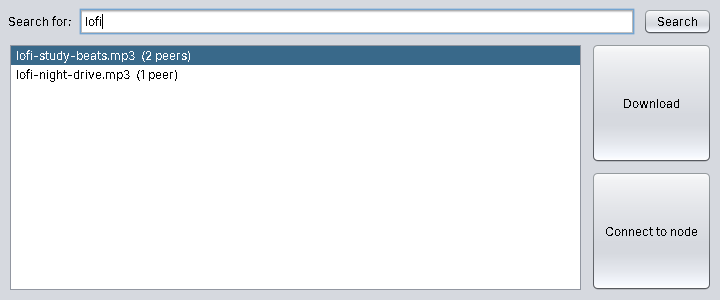
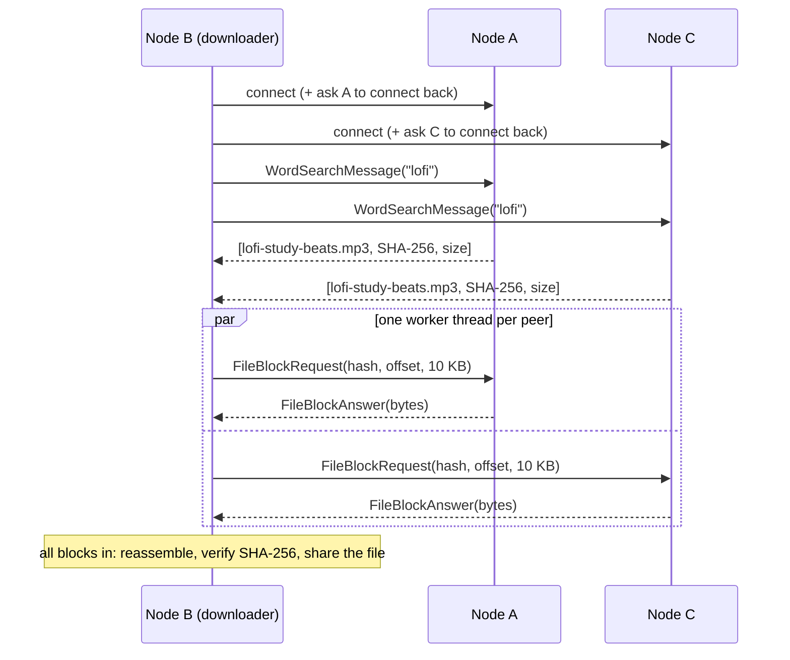

# IscTorrent

A peer-to-peer file-sharing network in plain Java, with no central server. Nodes search their peers for files by name and download each file in 10 KB blocks from every peer that has a copy, in parallel, then check the result against its SHA-256 hash.



Built with a partner for the Concurrent and Distributed Programming course at ISCTE, graded A. The point of the course was to write the concurrency and networking by hand: sockets, threads, monitors, a thread pool and a `CountDownLatch`, without any networking framework.

## How it works



- **No central server.** Every node runs a server socket that accepts peers and also opens client connections to the peers it chooses. A new connection asks the other side to connect back, so both can search and download from each other.
- **Search.** A keyword search goes to every connected peer. Results carry the file's **SHA-256**, so the same file offered by several peers is shown once with the number of peers that have it.
- **Parallel download.** A file is split into 10 KB blocks. One worker thread per peer keeps taking the next missing block from a shared list, so faster peers end up sending more blocks. A `CountDownLatch` sized to the number of blocks wakes the download once the last block arrives.
- **Integrity check.** The reassembled file is hashed and compared with the advertised SHA-256. A mismatch is discarded, and a match is added to the node's shared folder, so it can be served onward.
- **Bounded uploads.** Incoming block requests run on a fixed pool of **5 threads**, so a node never serves more than 5 blocks at the same time, however many peers are downloading from it.
- **Several downloads at once.** Each selected file gets its own download manager thread.

All messages are Java objects sent over TCP with object streams.

## Threads and coordination

| Component              | Threads                           | Coordination                                                                                        |
| ---------------------- | --------------------------------- | --------------------------------------------------------------------------------------------------- |
| `Server`               | 1 per node, accepting connections | —                                                                                                   |
| `ConnectionHandler`    | 1 per incoming connection         | Block reads go to the 5-thread upload pool, and replies are written under the handler's monitor     |
| `PeerConnection`       | 1 per outgoing connection         | A `ReentrantLock` per connection, so a request and its answer never interleave with another request |
| `DownloadTasksManager` | 1 per file being downloaded       | `synchronized` block list shared by the workers. `CountDownLatch` for "all blocks received"         |
| Download workers       | 1 per peer holding the file       | Take blocks until none are left. A failed peer returns its block for the others to fetch            |

## Running it

Requires a JDK, version 17 or newer. Run the commands from the repository root.

```bash
javac -d out src/isctorrent/*.java

# one terminal per node
java -cp out isctorrent.IscTorrent 8081 dl1
java -cp out isctorrent.IscTorrent 8082 dl2
java -cp out isctorrent.IscTorrent 8083 dl3
```

Each node shares the files in `shared/<folder>` (the folder is created if missing). To try it:

1. Copy a few files into `shared/dl1` and `shared/dl3`, including at least one file present in both, before starting the nodes.
2. In node 8082's window, click **Connect to node** and connect to `localhost:8081`, then to `localhost:8083`.
3. Search for part of a file name, select one or more results and click **Download**.
4. When it finishes, a summary shows how many blocks came from each peer and how long it took. The file appears in `shared/dl2`.

## Changes since the course submission

The graded version had the right structure, but testing it with several peers and files showed problems that only appear under load. This repository fixes them:

| Problem in the graded version                                                                                                                                                                          | Fix                                                                  |
| ------------------------------------------------------------------------------------------------------------------------------------------------------------------------------------------------------ | -------------------------------------------------------------------- |
| The lock guarding each connection was `static`, so one lock was shared by every connection, meaning only one block request could be in flight across all peers, and downloads ran one block at a time. | One lock per connection, and one worker thread per peer.             |
| Searches did not take that lock, so a search running during a download could read the other request's answer, and **downloading two files at once crashed** with `StreamCorruptedException`.           | Searches and block requests both go through the per-connection lock. |
| Each tiny request waited about 40 ms for a TCP acknowledgement (Nagle's algorithm meeting delayed ACKs).                                                                                               | `setTcpNoDelay(true)` on both ends.                                  |
| The downloaded file's hash was computed but never compared.                                                                                                                                            | Checked against the advertised SHA-256. Mismatches are discarded.    |

On the same machine, downloading a 3 MB file from two peers went from **14.2 s to 0.15 s**.

## Project layout

```
src/isctorrent/
  IscTorrent.java   entry point: java -cp out isctorrent.IscTorrent <port> <folder>
  Node.java         server, connections, search, block download and messages
  GUI.java          Swing window
shared/             one subfolder per node with the files it shares
docs/               screenshot
```

## Limitations

- Peers are found by connecting to them manually. There is no discovery or tracker.
- Search reaches directly connected peers only, not peers of peers.
- A download keeps every block in memory until the whole file has arrived.
- Messages use Java serialization, which is fine between trusted nodes but should not be exposed to untrusted ones.
